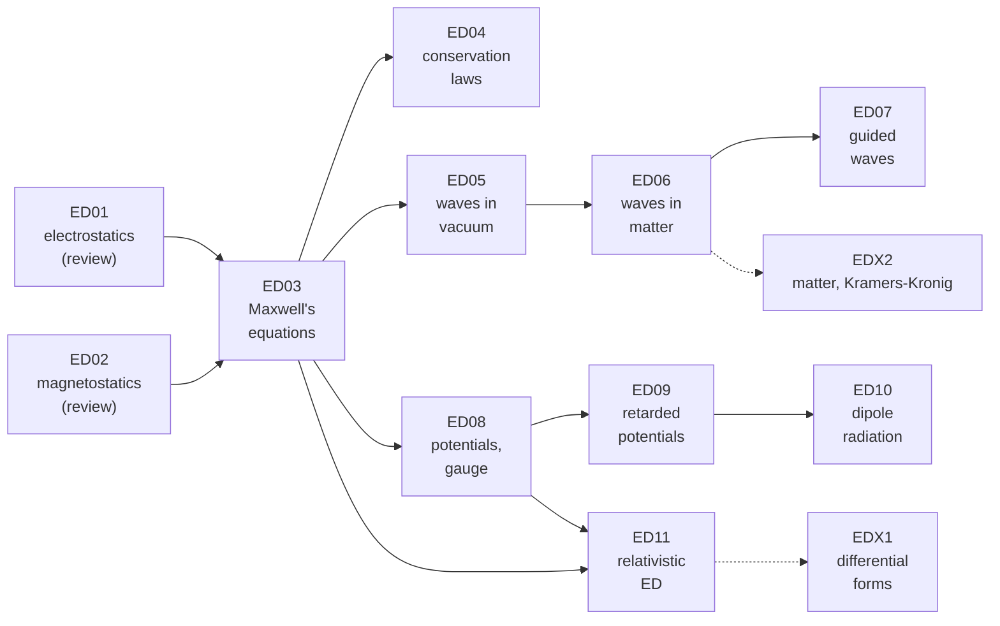

# Electrodynamics: Course Map

<span class="scope-taught">in course overview</span> <span class="scope-extra-book">extra · book</span> <span class="scope-extra-beyond">extra · beyond</span>

Planned as **eleven core chapters and two extras** on classical electrodynamics, following **PH3114 Electrodynamics-I** (IISER Pune, Aug 2024 outline, coordinator Dr. A. Arora, 4 credits). **Griffiths and Jackson are the two primary books, with equal priority** (user decision, 2026-11-04): every chapter lists both, Griffiths for the physical argument and worked cases, Jackson for the general derivation and the problems that go further; Feynman Vol. 2 and Landau-Lifshitz Vol. 8 (named in the overview) supply the third and fourth voices.

> [!warning] What is and is not in the sources
> - **"In course overview" (🟢)** means *listed in the PH3114 content page* (`physics/electromagnetism/PH3114.pdf`, one page): review of electro- and magnetostatics, Maxwell's equations, conservation laws, EM waves in vacuum and matter, guided waves, scalar and vector potentials, retarded potentials, gauge transformations, dipole radiation, relativistic electrodynamics. There are **no lecture notes, slides or problem sets** for this course in the folder; ordering and chapter splits are mine.
> - **Prerequisite:** Griffiths Ch. 1-6, so ED01-ED02 are deliberately short reviews.
> - **Units.** Griffiths (4th ed.) is SI. Jackson 3rd ed. states in §6.1 that its Maxwell equations are SI (the Chapter 6 running headers say "-SI"); which later chapters switch to Gaussian has **not yet been checked** (to confirm before ED11; Jackson's Appendix Tables 2-4 give the dictionary). All chapters here use SI unless a Gaussian formula is quoted and flagged.
> - **Extra · book (🟡)**: Zangwill, Wald, Hehl-Obukhov, Landau Vol. 2, Magyar's companion to Jackson; **extra · beyond (🔵)**: mine.
> - **Assessment (overview):** end-sem 40 %, mid-sem 30 %, others 30 %.

## Storyline

Central thread: **statics (ED01-ED02) cannot be extended unchanged to time dependence; Maxwell's one fix, the displacement current (ED03), makes the equations consistent with charge conservation (ED04) and predicts waves (ED05-ED07). Writing the fields through potentials (ED08) solves the sources-to-fields problem with a retardation delay (ED09), whose far-zone is radiation (ED10); the Lorentz covariance hidden in all of it is made explicit in ED11.**

## Chapters (planned)

Griffiths and Jackson section columns for unwritten chapters are *tbc*: they are filled in only after the passages are read (vault rule: cite only what was read).

| # | Chapter | Overview item | Griffiths | Jackson | Status |
|---|---|---|---|---|---|
| 01 | ED01 Electrostatics: Review | review | tbc | tbc | todo |
| 02 | ED02 Magnetostatics: Review | review | tbc | tbc | todo |
| 03 | [[ED03 Maxwell's Equations and Boundary Conditions]] | Maxwell's equations | §7.3 | Ch. 6.1-6.6 | **pilot draft** |
| 04 | [[ED04 Conservation Laws - Energy, Momentum, Angular Momentum]] | conservation laws | §8.1-8.2 | §6.7 | draft |
| 05 | [[ED05 Electromagnetic Waves in Vacuum]] | waves | §9.1.4, §9.2 | §7.1-7.2 | draft |
| 06 | [[ED06 Waves in Matter, Reflection and Dispersion]] | waves in matter | §9.3-9.4 | §7.3-7.5 | draft |
| 07 | [[ED07 Guided Waves]] | guided waves | §9.5 | Ch. 8 (§8.2-8.5) | draft |
| 08 | ED08 Potentials and Gauge Transformations | potentials, gauge | tbc | tbc | todo |
| 09 | ED09 Retarded Potentials and Liénard-Wiechert Fields | retarded potentials | tbc | tbc | todo |
| 10 | ED10 Dipole Radiation | dipole radiation | tbc | tbc | todo |
| 11 | ED11 Relativistic Electrodynamics | relativistic ED | tbc | tbc | todo |
| X1 | EDX1 Electromagnetism in Differential Forms (🟡) | extra | tbc | tbc | todo |
| X2 | EDX2 Macroscopic Electromagnetism and Kramers-Kronig (🟡) | extra | tbc | tbc | todo |

```dataview
TABLE chapter AS "#", scope AS "Scope", status AS "Status"
FROM #subject/electrodynamics AND #type/chapter
SORT chapter ASC
```

## Connections to other vaults
- **Waves:** ED05-ED07 are the electromagnetic instance of [[Waves - Course Map]].
- **Quantum Mechanics:** the gauge potential enters the Schrödinger equation by minimal coupling; dipole radiation (ED10) is the classical side of spontaneous emission; the $e^{-\kappa d}$ evanescent field in ED06-ED07 repeats the barrier of [[QM10 The Finite Barrier and Tutorial V]].
- **Classical Mechanics:** the EM Lagrangian and gauge symmetry (CMX2, [[Classical Mechanics - Course Map]]); relativistic mechanics of charges (ED11).
- **Differential Geometry:** EDX1 (forms, $F=dA$, $dF=0$) uses [[Differential Geometry - Course Map]].
- **Thermodynamics:** radiation pressure and the Poynting vector (ED04) feed blackbody and photon-gas arguments ([[Thermodynamics and Statistical Mechanics - Course Map]]).
- **Climate:** radiative transfer rests on ED05-ED06 (absorption, refractive index).

## Sources

| Role | Source (in `physics/electromagnetism/books/`) | Page offset (pdf = printed + …) |
|---|---|---|
| Primary 1 (overview) | D. J. Griffiths, *Introduction to Electrodynamics* (+ solutions) | +19 |
| Primary 2 | J. D. Jackson, *Classical Electrodynamics* 3rd ed. (1999) (+ Magyar's companion) | +26 |
| Overview | R. P. Feynman, Leighton, Sands, Vol. 2 (not in the folder; Vol. 1 only in the mechanics folder) | |
| Overview | L. D. Landau, E. M. Lifshitz, Vol. 8 *Electrodynamics of Continuous Media* (djvu) | |
| Companions | Purcell-Morin (+ solutions); Zangwill, *Modern Electrodynamics* (+ solutions); Landau Vol. 2; Wald; Hehl-Obukhov; Schwichtenberg | |
| Course outline | `physics/electromagnetism/PH3114.pdf` | |
